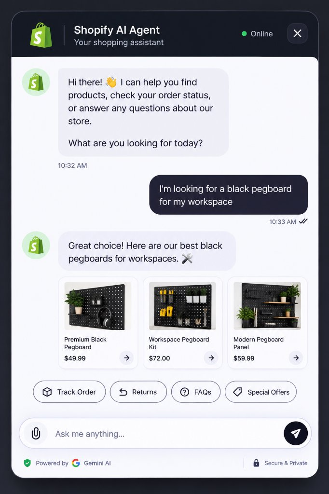
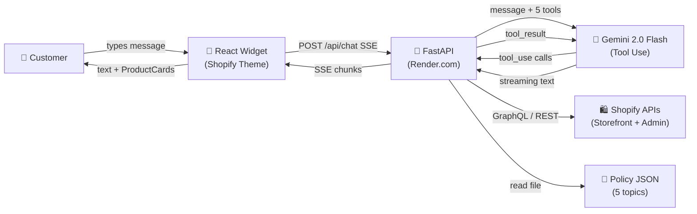

# 🛒 Shopify AI Agent

[](https://github.com/rahaman1721/shopify-ai-agent)
[](https://python.org)
[](https://fastapi.tiangolo.com)
[](https://aistudio.google.com)
[](LICENSE)

> **An AI shopping assistant for Shopify stores — powered by Gemini 2.0 Flash tool calling, real-time SSE streaming, and an embeddable React chat widget.**

Not just a chatbot. The agent calls real Shopify APIs to fetch live product data, check orders, and answer policy questions — it never guesses or invents answers. Supports Tamil + English.

<div align="center">
  <br/>
  
  <p><sub><b>Shopify AI Agent</b> — Embeddable React Chat Widget with interactive product carousel, bi-directional scrollable quick actions, and Gemini tool use</sub></p>
  <br/>
</div>

---

## ✨ Features

- 🔧 **5 Real Tools** — search products, get details, check orders, store policies, recommendations
- ⚡ **Streaming responses** — word-by-word SSE stream (like ChatGPT)
- 🃏 **Product cards in chat** — image, price, stock, "View Product" button rendered inline
- 🔍 **Debug panel** — live tool call log visible to show recruiters how the agent works
- 🌐 **Tamil + English** — responds in the customer's language
- 🛡️ **Security guardrails** — never invents prices, verifies email before order lookup
- 🆓 **100% free to run** — Gemini 2.0 Flash free tier (1,500 req/day)

---

## 🏗️ Architecture



---

## 🔧 The 5 Tools

| Tool | What it does |
|---|---|
| `search_products` | Searches Shopify catalogue by keyword |
| `get_product_details` | Returns all variants, sizes, stock for a product |
| `check_order_status` | Looks up order (requires order number + email verification) |
| `get_store_policy` | Returns shipping / returns / refund / warranty policy |
| `recommend_products` | Suggests similar or complementary products |

---

## 🚀 Quick Start

### Prerequisites
- Python 3.11+
- Node.js 20+
- [Google AI Studio account](https://aistudio.google.com) (free `GEMINI_API_KEY`)
- Shopify Partners development store (free)

### Backend

```bash
cd backend
python -m venv .venv
source .venv/bin/activate   # Windows: .venv\Scripts\activate
pip install -e ".[dev]"

cp ../.env.example .env
# Edit .env — add your GEMINI_API_KEY and Shopify tokens

uvicorn app.main:app --reload
# → API running at http://localhost:8000
# → Docs at http://localhost:8000/docs
```

### Widget

```bash
cd widget
npm install
npm run dev
# → Widget dev server at http://localhost:5173
```

### Run Tests

```bash
cd backend
pytest tests/ -v
```

---

## 🛠️ Tech Stack

| Layer | Technology |
|---|---|
| **LLM + Tool Use** | Google Gemini 2.0 Flash (free tier) |
| **Backend** | Python 3.11, FastAPI, Pydantic v2 |
| **Streaming** | Server-Sent Events (SSE) |
| **Frontend Widget** | React 19, TypeScript, Vite, Tailwind CSS |
| **Shopify** | Storefront GraphQL API + Admin REST API |
| **Rate Limiting** | slowapi |
| **Deployment** | Render.com (backend) + Vercel (widget) |

---

## 📁 Project Structure

```
shopify-ai-agent/
├── backend/
│   ├── app/
│   │   ├── main.py                 ← FastAPI app entry point
│   │   ├── core/config.py          ← Settings from .env
│   │   ├── routers/chat.py         ← POST /api/chat (SSE)
│   │   ├── services/
│   │   │   ├── gemini_agent.py     ← Gemini tool use loop
│   │   │   ├── shopify.py          ← Shopify API calls
│   │   │   └── policies.py         ← Policy JSON loader
│   │   ├── tools/definitions.py    ← 5 tool schemas
│   │   ├── models/schemas.py       ← Pydantic models
│   │   └── data/policies/          ← 5 JSON policy files
│   └── tests/
├── widget/                         ← Embeddable React chat widget
├── docs/screenshots/               ← UI demo screenshots
└── .env.example
```

---

## 🗺️ Roadmap & Verified Milestones

- [x] FastAPI skeleton + architecture setup
- [x] 5 tool definitions (`search_products`, `get_product_details`, `check_order_status`, `get_store_policy`, `recommend_products`)
- [x] Policy JSON store (shipping, returns, refunds, warranty, exchanges)
- [x] Gemini 2.0 Flash tool use loop (`gemini_agent.py`)
- [x] Shopify Storefront API GraphQL & Admin REST client (`shopify.py`)
- [x] SSE streaming router (`/api/chat`)
- [x] React 19 chat widget matching Shopify design (`widget/`)
- [x] Inline Product Cards carousel with real image previews
- [x] Live Debug Panel for tool logs & execution telemetry
- [x] Bi-directional smooth scroll for quick action pills (Drag + Mouse wheel + Touch)
- [x] Tamil + English bilingual query support
- [x] Production Dockerfile & Vercel IIFE bundle configuration

---

## 💡 What I Learned

- **Agentic AI loops:** How to implement multi-turn tool calling where the LLM decides which tools to call, executes them, and continues reasoning.
- **SSE streaming:** How to stream LLM responses chunk-by-word from FastAPI to a React frontend using Server-Sent Events.
- **Security in AI agents:** Why AI agents must never be trusted to invent data — always verify tool outputs and enforce guardrails like email verification for sensitive operations.
- **Shopify APIs:** GraphQL Storefront API (public) vs Admin REST API (private) — when to use which and how to keep Admin tokens secure.

---

## 👨‍💻 Author

**Obaidhur Rahaman**  
Full Stack Developer & Lead UI/UX Designer

- 🌐 [rahaman1721.framer.website](https://rahaman1721.framer.website)
- 🐙 [@rahaman1721](https://github.com/rahaman1721)
- 💼 [linkedin.com/in/obaidhur-rahaman-1721z](https://www.linkedin.com/in/obaidhur-rahaman-1721z)
- 📧 [rahaman171920@gmail.com](mailto:rahaman171920@gmail.com)

<div align="center">
  <sub>Built with precision by Obaidhur Rahaman © 2026</sub>
</div>
